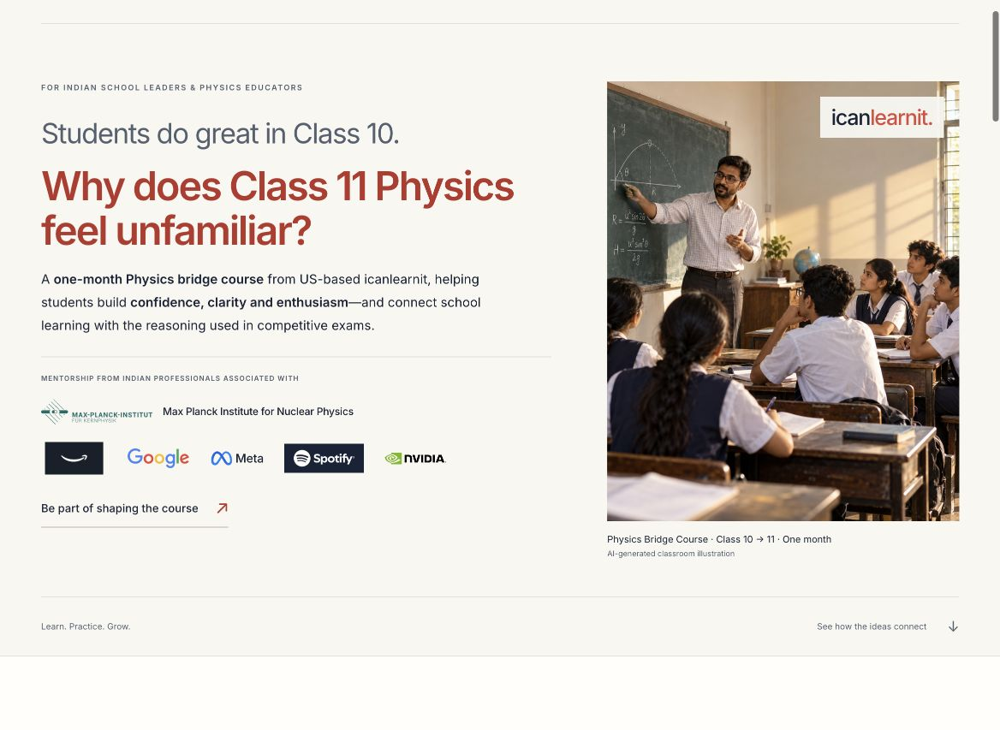

# icanlearnit — Physics bridge course landing page

[Developer start guide](START_HERE.md) · [Page copy](docs/CONTENT.md) · [Desktop preview](previews/desktop.jpg) · [Mobile preview](previews/mobile.jpg)



A responsive React component, CSS Module, and runnable Next.js reference app. This is the page accompanying the school outreach email. It is a developer handoff, not a deployed website or a school demo.

This revision preserves the approved visual direction and grounds the teaching example and course outline in the supplied manuscript. The robot data and graph use an initial position of 5 m and a slope of 4 m/s. Source provenance and the editorial review are included for the developer and owner.

## Quick start

Use Node.js 20.9 or newer and pnpm. Exact tested dependency versions are recorded in package.json and pnpm-lock.yaml.

```sh
pnpm install --frozen-lockfile
pnpm dev
```

Open http://127.0.0.1:3000. For production checks:

```sh
pnpm typecheck
pnpm build
pnpm preflight
```

`preflight` intentionally fails until real booking and canonical URLs are supplied. A successful build confirms the page compiles; it does not confirm the calendar connection. `pnpm build` produces the static `out/` directory. Use a static host for this output; `next start` is not supported with static export. For a server-rendered deployment, remove `output: "export"` from next.config.mjs and then use `pnpm build` / `pnpm start`.

## Connect Google Calendar before launch

Edit `src/physics/site-config.ts`:

```ts
bookingUrl: "https://calendar.google.com/calendar/appointments/schedules/YOUR_PUBLIC_SCHEDULE_ID",
canonicalUrl: "https://icanlearnit.com/physics/",
```

Use your actual public Google Calendar appointment schedule booking link, not the example URL. A shared invitation to a fixed event is a different flow: it does not let each school choose its own meeting time. Set the appointment duration to 30 minutes, use your real availability, and check the experience for an educator in India. Supported public HTTPS scheduling links, including Google short links, work without embedding or third-party scripts. Calendar owns availability, attendee details, confirmation, and meeting creation. No credentials belong in this project.

Official setup: https://support.google.com/calendar/answer/10729749

With bookingUrl blank, header and hero CTAs scroll to the meeting section, which honestly says that the calendar is coming soon. The final booking button is disabled. Replace the URL and rebuild before public outreach. No fake form submission, local storage, email submission, or calendar event is created.

Optional configuration:

- `contactEmail`: a real contact address; adds a mailto fallback when supplied.
- `logoSrc`: URL/path to the original approved horizontal logo. No logo artwork was supplied separately. The default is a plain-text brand name, not a recreation of the cape artwork.
- `founderPortraitSrc`: optional current portrait. The default biography works without a photo.
- `canonicalUrl`: actual public page URL; leave empty during review to avoid announcing an unconfirmed canonical.

## Plug into an existing Next.js App Router website

1. Copy the entire `src/physics/` directory into the existing project, including `fonts/` and its license.
2. Keep the local font-face declarations, or change them to use the site's existing Inter font. No font package is needed at runtime.
3. Create the route `app/physics/page.tsx` and import/render `PhysicsLanding`. The supplied `app/page.tsx` shows the metadata and import pattern; adjust relative paths for the new location.
4. Keep the site's existing root layout. Do not replace it with the reference `app/layout.tsx`. Decide whether to retain the component's navigation/footer or use the site's shell; avoid duplicate headers.
5. Set the configuration, then run your normal production build. No API route or server secret is required.

CSS Module classes and root-scoped typography prevent this component from restyling the rest of your site. Section IDs begin as ordinary page anchors; keep them unique if multiple components share the page.

For the Next.js Pages Router, render the same component from `pages/physics.tsx`, bring metadata into `next/head`, and keep the existing app layout. For a non-Next React app with CSS Modules, render the component in your router and set metadata through your application's normal mechanism. There is no runtime dependency on next/link, next/image, or Next-specific hooks in the component.

## Host the standalone export

For `physics.icanlearnit.com`, leave NEXT_PUBLIC_BASE_PATH unset, set canonicalUrl to the final URL, run the production build, and deploy the contents of `out/` at the subdomain root.

For a standalone build mounted under `/physics/`:

```sh
NEXT_PUBLIC_BASE_PATH=/physics pnpm build
```

Place the CONTENTS of `out/` inside the web server's `/physics/` directory, including its `_next/` directory and hidden files if any. Example: the generated `out/index.html` becomes `/physics/index.html`, and `out/_next/` becomes `/physics/_next/`. Enable the normal trailing-slash/index.html behavior. Do not apply this basePath when using the existing app's own `app/physics/` route.

For optional logo and portrait assets, use public paths matching the hosting location (for example `/physics/assets/logo.png` for the standalone subpath build). The project does not rewrite configured asset URLs. Avoid loading remote imagery without permission.

## What's in the packet

- `src/physics/`: reusable component, CSS Module, public configuration, and licensed local Inter fonts.
- `src/physics/course-content.ts`: editable public episode summaries, robot data, and school FAQ copy. Keep the graph and table data together when editing.
- `app/`, `next.config.mjs`, package files: a runnable reference app.
- `out/`: generated by `pnpm build`; build output is intentionally not committed. Booking is unset until configured.
- `docs/CONTENT.md`: human-readable page copy.
- `docs/CONTENT_NOTES.md`: fact boundaries and launch dependencies.
- `docs/DESIGN_TOKENS.md`: visual decisions and integration details.
- `docs/QA_REPORT.md`: verified checks and limitations.
- `docs/EVIDENCE_MAP.md`: course references and owner-email provenance; do not publish this internal document as page content.
- `docs/EDITORIAL_REVIEW.md`: the ten completed copy-quality checks.
- `previews/`: desktop and mobile page captures.

## Before launch

- Supply and test the real public Google Calendar booking URL; confirm 30-minute duration and usable availability.
- Set the final canonical URL and rebuild for the selected route.
- Confirm the latest founder biography and individual mentor participation.
- Replace the temporary text brand name with original logo artwork if available; add a current portrait if desired.
- Review copy with the outreach email. No old prototype modules, biographies, or statistics have been assumed current.
- The course manuscript and private links are not part of the packet. The public outline uses eight supplied episodes and a separately labelled capstone chapter. The later meaning question is a separate course extract from the robot exercise.
- Confirm the site's privacy policy covers the actual scheduling service if required by your existing site setup. This page itself sets no custom cookies, embeds no analytics, and collects no visitor information.
- Add any analytics through your site's existing consent and reporting system. A CTA click is not a confirmed meeting. The packet contains no tracking service.
- Run preflight and the production build, check mobile and keyboard behavior, and test the exact hosted path.

Source: https://nextjs.org/docs/app/getting-started/installation

## Download and share

Share this repository URL with your developer: https://github.com/rahuljakhmola/icanlearnithome

Use GitHub’s **Code → Download ZIP** to download the source. The application source, fonts, documentation, and previews are included. Build output, dependencies, the private course manuscript, and earlier campaign drafts are excluded.
